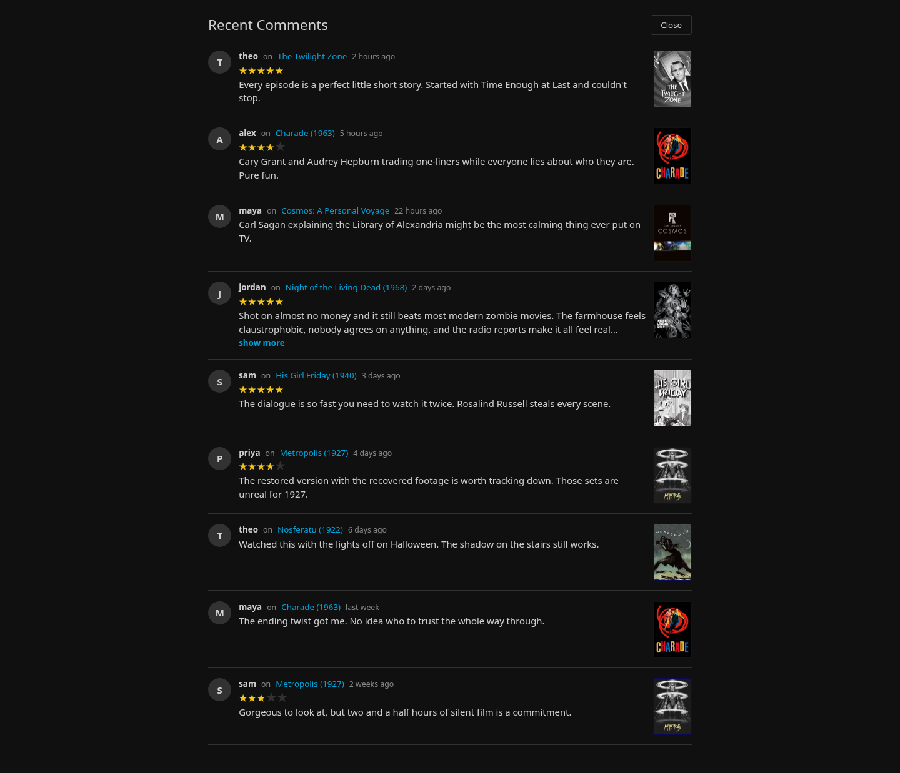
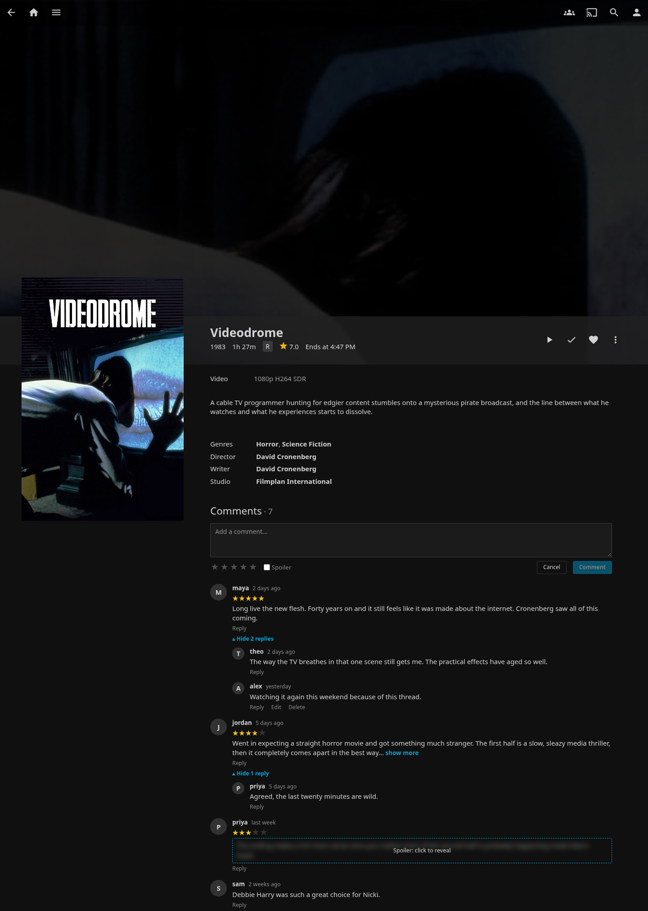
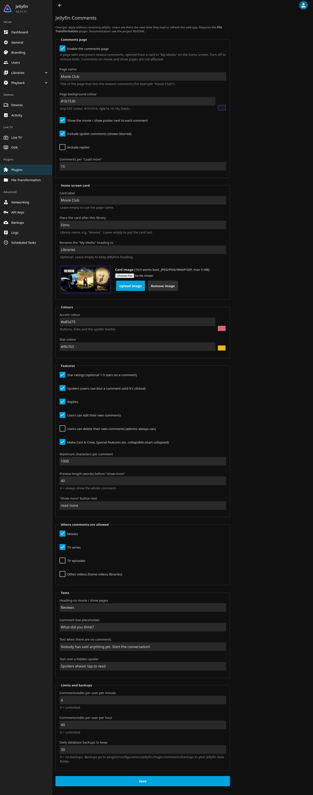

# Cozy Comments

**A comment and rating system for shared users on Jellyfin.**

Cozy Comments adds a comment section to every movie, series and episode page in the Jellyfin web app,
plus a comments page that shows everyone's newest comments, opened from a card on the home screen.
You choose the page's name, image and colours, and turn each feature on or off.

- **Comments** on movies, series, episodes and home videos, shown under the item's details
- **Star ratings**: an optional 1–5 stars with each comment (the star colour is up to you)
- **Spoilers**: a comment can be marked as a spoiler and stays blurred until someone clicks it
- **Replies**, one level deep, collapsed under "View N replies"
- **Edit and delete** your own comments. Admins can delete any comment
- **Comments page**: everyone's newest comments with posters, opened from a card in *My Media*.
  You pick its name ("Recent Comments", "The Lobby", "Movie Club"…), image and background colour,
  or turn it off completely
- **"Show more"**: long comments are cut after N words, and you choose the button text
- **Respects library access**: people only see comments on items they're allowed to see
- **Settings in the Dashboard**, or in a `comments.conf` file you can push with one command
- **Everything stays on your server**: one SQLite file, daily backups, no outside services

## Screenshots

**The comments page**



**Comments, ratings and replies on a movie page**



**Settings (Dashboard → Plugins → Cozy Comments)**



---

## Contents

- [Requirements](#requirements)
- [Installation](#installation)
  - [Option A: plugin repository (recommended)](#option-a-plugin-repository-recommended)
  - [Option B: manual install from a zip](#option-b-manual-install-from-a-zip)
  - [Still on Jellyfin 10.11?](#still-on-jellyfin-1011)
- [Configuration](#configuration)
  - [In the Dashboard](#in-the-dashboard)
  - [With a settings file (`comments.conf`)](#with-a-settings-file-commentsconf)
- [Which apps show comments?](#which-apps-show-comments)
- [Where are comments stored? Backups](#where-are-comments-stored-backups)
- [Updating and uninstalling](#updating-and-uninstalling)
- [Troubleshooting](#troubleshooting)
- [Privacy and security](#privacy-and-security)
- [Credits and license](#credits-and-license)

---

## Requirements

| | |
|---|---|
| **Jellyfin** | **12.x** for Cozy Comments 2.x (installs on Linux, Windows, macOS, Docker, NAS…). Still on **10.11.x**? Use Cozy Comments **1.2.2.0**; the plugin repository offers each server the version that fits it. |
| **File Transformation plugin** | Needed, in the build for your Jellyfin version (its repository offers the right one). It's what lets plugins add things to the web app without changing Jellyfin's files. Installation is below. |
| **Clients** | The Jellyfin web app and the apps that load it from your server (see [Which apps show comments?](#which-apps-show-comments)) |

## Installation

### Option A: plugin repository (recommended)

This is the easiest way, and Jellyfin will tell you when there's an update.

1. **Install File Transformation** (if you don't already have it):
   1. Go to **Dashboard → Plugins → Repositories** (on older layouts, **Dashboard → Plugins → Catalog → Settings**).
   2. Click **+** and add:
      - Name: `File Transformation`
      - URL: `https://www.iamparadox.dev/jellyfin/plugins/manifest.json`
   3. Open **Catalog**, find **File Transformation**, and click **Install**.
2. **Install Cozy Comments**:
   1. Add another repository:
      - Name: `Cozy Comments`
      - URL: `https://raw.githubusercontent.com/DuotronicFish/jellyfin-plugin-cozycomments/main/manifest.json`
   2. Open **Catalog**, find **Cozy Comments** (category *General*), and click **Install**.
3. **Restart Jellyfin** (Dashboard → **Restart**, or restart the service or container).
4. Reload the web app. There's now a **Comments** section on every movie and show page, and a
   **Recent Comments** card in *My Media* on the home screen.

### Option B: manual install from a zip

1. Install **File Transformation** as in step 1 above (or from its
   [releases page](https://github.com/IAmParadox27/jellyfin-plugin-file-transformation/releases), using the same steps as below).
2. Download `cozycomments_<version>.zip` from the
   [Releases page](https://github.com/DuotronicFish/jellyfin-plugin-cozycomments/releases).
3. Make a folder called `cozycomments_<version>` (for example `cozycomments_2.0.1.0` on Jellyfin 12.x, `cozycomments_1.2.2.0` on 10.11.x) inside your Jellyfin
   **plugins** folder, and unzip the files into it:

   | How Jellyfin is installed | Plugins folder |
   |---|---|
   | Linux (deb/rpm package) | `/var/lib/jellyfin/plugins/` |
   | Docker, official `jellyfin/jellyfin` image | `/config/plugins/` inside the container (the `plugins` folder in the volume you mounted at `/config`) |
   | Docker, `linuxserver/jellyfin` image | `/config/data/plugins/` inside the container |
   | Windows | `%ProgramData%\Jellyfin\Server\plugins\` (or `%LocalAppData%\jellyfin\plugins\` for the tray app) |
   | macOS | `~/.local/share/jellyfin/plugins/` |

   Not sure? **Dashboard → Paths** lists your *Data* folder. `plugins` is inside it.
4. On Linux, make sure Jellyfin's user can read the folder, for example
   `sudo chown -R jellyfin:jellyfin /var/lib/jellyfin/plugins/cozycomments_2.0.1.0`.
5. Restart Jellyfin.

### Still on Jellyfin 10.11?

Cozy Comments **2.x** is for Jellyfin **12.x**. For Jellyfin **10.11.x** there is **1.2.2.0**, which has the same
features and keeps working.

| Your Jellyfin (Dashboard → About) | Cozy Comments version |
|---|---|
| 12.x | 2.x (latest) |
| 10.11.x | 1.2.2.0 |

- **Plugin repository (Option A):** nothing to change. Add the same repository URL and Jellyfin's Catalog
  offers 1.2.2.0 on a 10.11 server and 2.x on a 12 server by itself. File Transformation's repository does the
  same for its own builds.
- **Manual install (Option B):** download `cozycomments_1.2.2.0.zip` from the
  [1.2.2.0 release](https://github.com/DuotronicFish/jellyfin-plugin-cozycomments/releases/tag/v1.2.2.0), and use the
  File Transformation build made for 10.11.
- **Source code:** the [`jellyfin-10.11`](https://github.com/DuotronicFish/jellyfin-plugin-cozycomments/tree/jellyfin-10.11)
  branch. New features go into 2.x; 1.2.x only gets serious bug fixes.
- **Upgrading Jellyfin to 12 later:** upgrade Jellyfin, then update File Transformation and Cozy Comments to
  their 12 versions and restart. Your comments and settings are kept.

## Configuration

All settings apply **without restarting Jellyfin**. People see the change the next time they open
or refresh the web app.

### In the Dashboard

**Dashboard → Plugins → Cozy Comments** (or **My Plugins → Cozy Comments → Settings**). Every option is on this page,
and you can upload the card image there too.

### With a settings file (`comments.conf`)

If you prefer a text file (handy for keeping your setup in version control, or setting up several servers):

1. Copy the example file:
   ```bash
   cp comments.conf.example comments.conf
   ```
2. Edit `comments.conf`. Each option has a comment explaining it:
   ```ini
   [server]
   url = http://localhost:8096
   # Dashboard > API Keys > +
   api_key = 0123456789abcdef0123456789abcdef

   [page]
   # Name of the comments page
   name = The Lobby
   # Card image (16:9 looks best). "none" removes it
   image = my-cover.jpg
   background_color = #14213d

   [colors]
   star_color = #ffb703

   [features]
   replies = yes
   preview_word_limit = 40
   show_more_text = read more
   ```
3. Apply it (Python 3 is the only requirement; works on Linux, macOS and Windows):
   ```bash
   python3 scripts/configure.py comments.conf --dry-run   # preview the changes
   python3 scripts/configure.py comments.conf             # apply them
   ```

Settings you leave empty keep the value they already have on the server. To keep the API key out of the file,
set the `JELLYFIN_API_KEY` environment variable instead. `python3 scripts/configure.py --show` prints what's
on the server right now.

### All settings

| Setting | `comments.conf` | Default | What it does |
|---|---|---|---|
| Comments page on/off | `[page] enabled` | yes | Master switch for the comments page and its home screen card. Comments on movie / show pages keep working |
| Page name | `[page] name` | `Recent Comments` | Title of the comments page (and the home card label, unless you set one) |
| Card image | `[page] image` | none (icon) | Image on the home card. JPEG/PNG/WebP/GIF, max 5 MB |
| Page background colour | `[page] background_color` | `#101010` | Background of the comments page |
| Show posters | `[page] show_posters` | yes | Poster next to each comment on the comments page |
| Spoilers on the page | `[page] show_spoilers` | no | Include spoiler comments (blurred) on the comments page |
| Replies on the page | `[page] show_replies` | no | Include replies on the comments page |
| Page size | `[page] page_size` | 20 | Comments loaded per "Load more" (1–50) |
| Card label | `[home] card_label` | *(page name)* | Text under the card |
| Card position | `[home] card_after_library` | *(last)* | Put the card after this library |
| Rename "My Media" | `[home] rename_my_media_to` | *(off)* | New heading for the *My Media* row |
| Accent colour | `[colors] accent_color` | `#00a4dc` | Buttons, links, "show more", spoiler border |
| Star colour | `[colors] star_color` | `#f5c518` | Colour of the rating stars |
| Star ratings | `[features] star_ratings` | yes | Optional 1–5 stars with a comment |
| Spoilers | `[features] spoilers` | yes | Let users mark comments as spoilers |
| Replies | `[features] replies` | yes | Let users reply to comments |
| Editing | `[features] editing` | yes | Let users edit their own comments |
| Deleting | `[features] deleting` | yes | Let users delete their own comments (admins always can) |
| Max length | `[features] max_comment_length` | 2000 | Max characters per comment (1–10000) |
| Preview length | `[features] preview_word_limit` | 30 | Words shown before "show more". 0 = never cut |
| "Show more" text | `[features] show_more_text` | `show more` | Text of the expand button |
| Collapsible sections | `[features] collapse_detail_sections` | no | Cast & Crew, Special Features etc. get a +/− button and start collapsed |
| Where comments are allowed | `[allow_comments_on] movies / series / episodes / videos` | all yes | Turn comments off for some item types |
| Texts | `[texts] section_title / input_placeholder / empty_text / spoiler_text` | | Change the wording |
| Rate limits | `[limits] per_minute / per_hour` | 6 / 60 | Comments plus edits per user. 0 = unlimited |
| Backups | `[limits] backups_to_keep` | 14 | Daily database backups to keep. 0 = off |

More detail on each setting is in [docs/CONFIGURATION.md](docs/CONFIGURATION.md).

Turning a feature **off** never deletes anything. Existing stars, spoilers and replies are kept. They're
just hidden (stars) or can't be added any more, and they're back if you turn the feature on again.

## Which apps show comments?

Comments are added to Jellyfin's **web app**, so they show up wherever your server's web app runs:

| Shows comments | Doesn't show comments |
|---|---|
| Any browser | Android TV / Fire TV app |
| Jellyfin for Android (phone/tablet) | Swiftfin (iOS/tvOS) |
| Jellyfin for iOS | Roku, webOS, Tizen, Kodi, Infuse… |
| Jellyfin Media Player / Jellyfin Desktop (when connected to your server) | Other apps with their own interface |

If a mobile app doesn't show comments right after you install the plugin, close the app completely and
open it again (clear its cache if that doesn't help).

## Where are comments stored? Backups

Comments are kept in one SQLite file in your Jellyfin data folder:

```
<Jellyfin data folder>/plugins/configurations/Jellyfin.Plugin.CozyComments/comments.db
```

The scheduled task **Back up comments database** (Dashboard → Scheduled Tasks → *Cozy Comments*) runs every
day and when the server starts. It copies the database to `backups/comments-YYYY-MM-DD.db` next to it and
keeps the newest 14 (you can change that number).

**Restoring a backup:** stop Jellyfin, move `comments.db`, `comments.db-wal` and `comments.db-shm` out of
the way, copy the backup in as `comments.db`, and start Jellyfin.

## Updating and uninstalling

- **Update:** if you used the plugin repository, Jellyfin shows the update under **Dashboard → Plugins**.
  Install it, then restart. Comments and settings are kept.
- **Uninstall:** Dashboard → Plugins → Cozy Comments → **Uninstall**, then restart. The web app goes back
  to normal. Your comments stay in `comments.db`, so if you reinstall later they're all still there. Delete the
  `Jellyfin.Plugin.CozyComments` folder (see above) to remove them for good.

## Troubleshooting

| Problem | Fix |
|---|---|
| No comment section anywhere | Is **File Transformation** installed and *Active* (Dashboard → Plugins)? Did you restart after installing both? Hard-refresh the browser (Ctrl+Shift+R). |
| Plugin shows *NotSupported* / *Malfunctioned* | The plugin version doesn't match your Jellyfin: 2.x needs Jellyfin 12.x, 1.2.2.0 is for 10.11.x. Check **Dashboard → About**. After upgrading Jellyfin from 10.11 to 12, update File Transformation and Cozy Comments too. |
| Works in the browser but not in the phone app | Fully close and reopen the app; clear the app's cache if needed. |
| Settings don't change anything | Refresh the page; settings are read when the web app loads (and then every minute). |
| `configure.py` says 401 | The API key is wrong. Create a new one in **Dashboard → API Keys**. |
| Home card is missing | It only shows when the comments page is enabled and the home screen has a *My Media* section. |
| "Cozy Comments isn't answering on this server" or *Request failed (404)* | The page was opened before the plugin was installed, updated or restarted, so it's running an old copy. Reload the page (Ctrl+Shift+R, or close and reopen the app). If it stays, check that Cozy Comments is *Active* in Dashboard → Plugins and restart Jellyfin. |
| "Cozy Comments was updated on the server" | A newer version was installed while the page was open. Click **Reload**. |
| Something else | Check the server log (Dashboard → Logs) for lines that start with `[Cozy Comments]`, and open an issue. |

## Privacy and security

- Comments **never leave your server**. The plugin makes no outside connections and has no telemetry.
- Every request is checked against Jellyfin's own permissions: a user who can't see a movie can't read or post
  comments on it, and its comments don't show up for them on the comments page.
- Comments are tied to the signed-in Jellyfin user. API keys can change settings, but can't post as a user.
- All comment text is shown as plain text (no HTML), so a comment can't inject code into other people's browsers.
- Per-user rate limits stop spam. Admins can delete any comment from the comment itself.
- The web app is changed **in memory** by File Transformation. No Jellyfin files on disk are modified.

## Credits and license

- Released under the [MIT License](LICENSE).
- Uses [File Transformation](https://github.com/IAmParadox27/jellyfin-plugin-file-transformation) by IAmParadox27
  (GPL-3.0, installed separately; Cozy Comments only talks to it at runtime and includes none of its code).
- Not affiliated with the Jellyfin project.
- Coding assistance from Claude, tested on multiple server instances, heavily reviewed for security and efficiency, project will be closely maintained.
